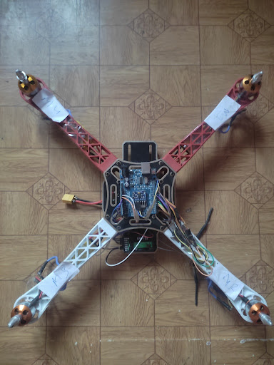

# Custom Arduino Drone Flight Controller & Setup Utility

---

## Tech Stack & Hardware
- **Language:** c++ (Arduino)
- **Microcontroller:** Arduino Uno (ATmega328p)
- **Sensor:** MPU6050 6-axis Gyroscope / Accelerometer
- **Transmitter/Receiver:** FlySky FS-i6
- **Libraries:** `<Wire.h>`, `<EEPROM.h>`
- **Developemnt Tools:** VS Code, Arduino IDE, Git

---

## How it was made & How the code works

Building a flight controller from scratch requires strict timing control because a quadcopter needs continuous, rapid attitude corrections. Here is how the core pieces of this project work:

### 1. Zero-latency Receiver via Pin Change Interrupts
Instead of using slow `pulseIn()` functions which block execution, this code uses direct port manipulation and Pin Change Interrupts (`PCICR`, `PCMSK0`, and `ISR(PCINT0_vect)`). Whenever pins 8 through 11 change state (triggered by PWM pulses from the radio receiver), the microcontroller instanly records `micros()` timestamps on the rising and falling edges. This allows the flight controller to capture raw receiver input channels with high precision.

## 2. High-Speed I2C Communication
To ensure the MPU-6050 gyro updates fast enough for stable flight, the code manually forces the I2C clock speed up to **400kHz** (`TWBR = 12`), verifying the clock speed during the system check phase before proceeding.

## 3. Interactive Serial calibration Wizard
When you boot up the system and open the Serial Monitor (at 57600 baud), `loop()` acts as an interactive setup wizard:
- **System Check:** Verifies I2C clock speed and looks for valid receiver sticks on digital pins 8-11 (throwin `ERROR 1` or `ERROR 8` if hardware is missing or misconfigured).
- **Stick Center Calibration:** Waits for you to center your transmitter sticks and records baseline trim values.
- **Channel Assignment & Inversion:** Automatically detects which physical stick corresponds to Throttle, Roll, Pitch, and Yaw, and checks if any channels are inverted.
- **Endpoint Measurement (`register_min_max`):** Measures the absolute minimum and maximum thows of your sticks.
- **Gyroscope Discovery & Calibration:** Scans for the MPU-6050 at addresses `0x68` or `0x69`, starts up the sensor registers, keeps the quadcopter still to calculate gyro drift offsets across 2,000 samples (`gyro_signalen`), and checks physical axis orientation by having you tilt the drone.
- **EEPROM Storage:** Once all checks pass without errors (`error == 0`), all center points, endpoints, channel assignments, and magic verification bytes (`'J', 'M', 'B'`) are writtem to the Atmega328P's EEPROM and verified.

---

## Installation & Running Guide

### Hardware Wiring
1. **MPU-6050 Gyro:** Connect `SDA` to Analog Pin 4 ( or dedicated SDA pin), `SCL` to Analog Pin 5 (or SCL pin), `VCC` to 5V and `GND` to GND.
2. **Receiver Channels:** Connect your receiver channel output to digital pins **8, 11** (mapped accross PORTB in the interrupt vector).

### Software Setup
1. Download and install the [Arduino IDE](https://www.arduino.cc/en/software).
2. Clone or download this repository and open the `.ino` file in the Arduino IDE.
3. Connect your Arduino Uno via USB, go to **Tools > Board**, and select **Arduino Uno**. Choose your correct COM port under **Tools > Port**.
4. Click the **Upload** button to flash the sketch onto your board.

### Running the Calibration
1. Open the **Serial Montor** in the Arduino IDE and set the baud rate to **57600**.
2. Follow the on-screen prompts printed in the serial terminal:
   - Center all sticks when requested
   - Move throttle, roll, pitch and yaw sticks as prompted to map channels.
   -Keep the quadcopter completely still during gyro offset calibration.
   -Tilt the drone and rotate it when prompted to verify gyro axis directions.
3. Look for the message `"The setup is finished."` and `"Verification done."` confirming your settings are saved to EEPROM.

---

## Images & Demos
- **Physical Drone Hardware Build:**

